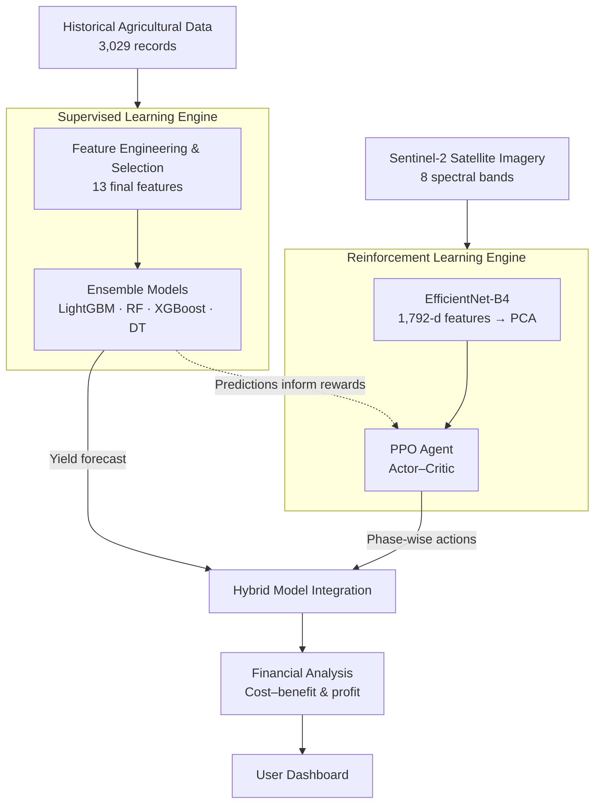
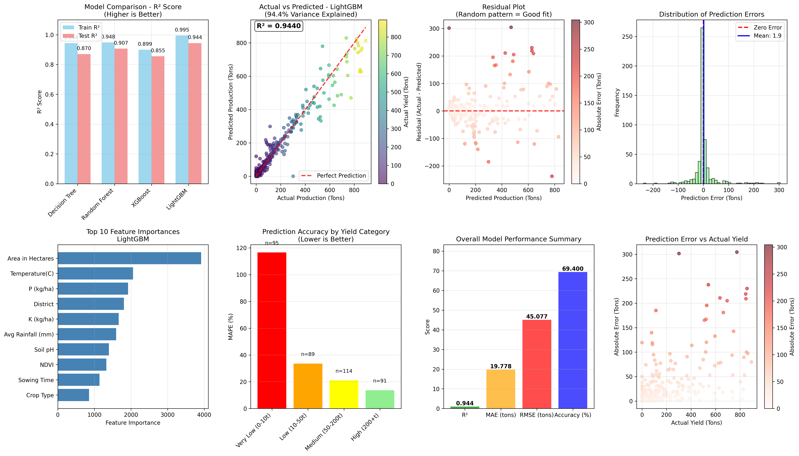
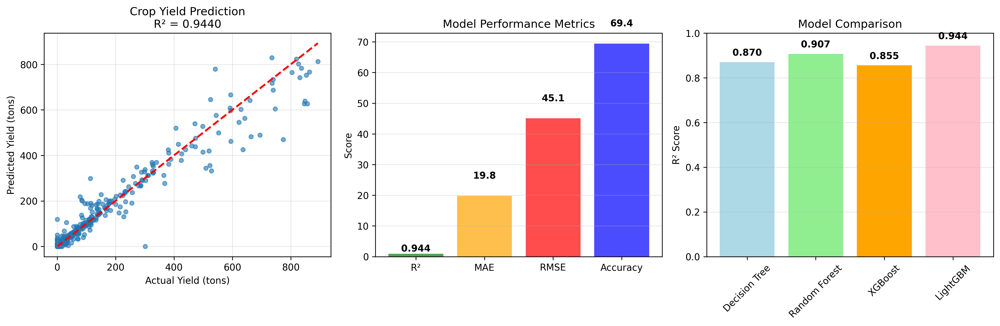
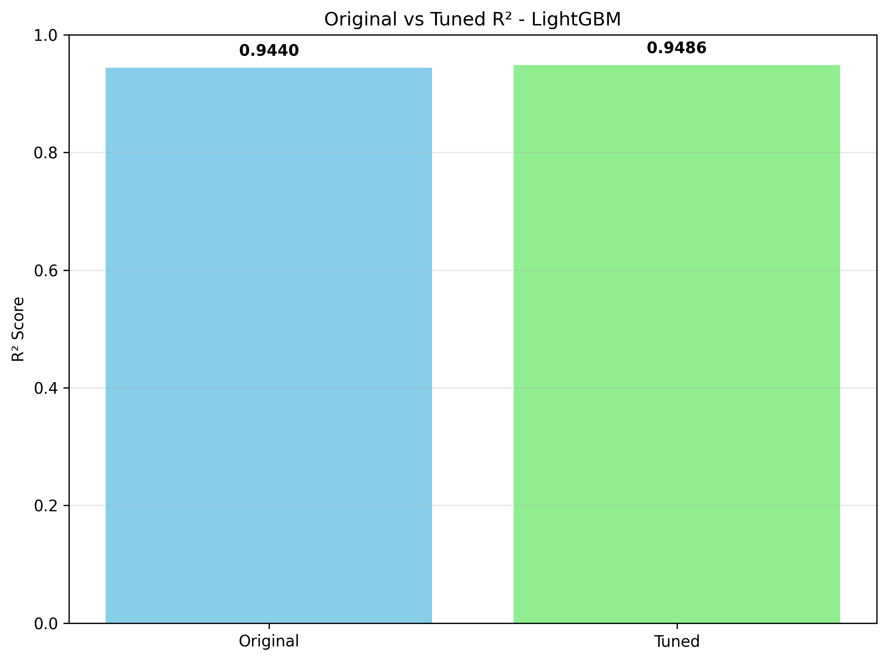
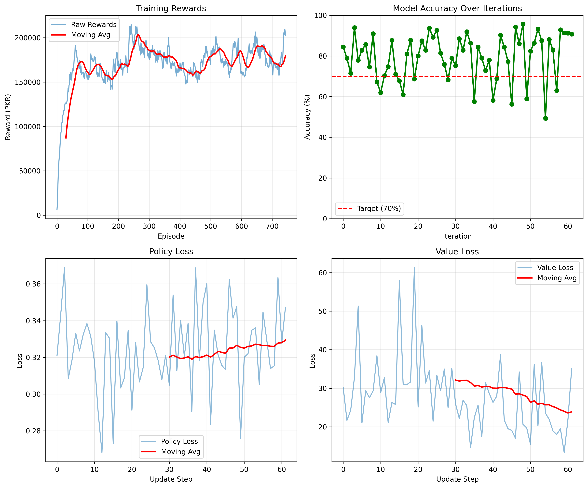

# HRSL Crop Yield Optimizer

### Enhancing Agriculture Productivity Using Hybrid Reinforcement and Supervised Learning Models


HRSL Crop Yield Optimizer is a final year project from the Department of Computer Science, Bahria University, Karachi. It combines two machine learning paradigms in one system. A supervised learning engine forecasts crop yield from historical agricultural records, and a reinforcement learning engine recommends phase-wise farming actions (sowing, vegetative, harvesting) using satellite imagery and a profit-oriented reward function.

---

## Table of Contents

- [Motivation](#motivation)
- [Key Results](#key-results)
- [System Overview](#system-overview)
- [Architecture](#architecture)
- [Repository Structure](#repository-structure)
- [Supervised Learning Component](#supervised-learning-component)
- [Reinforcement Learning Component](#reinforcement-learning-component)
- [Web Application](#web-application)
- [Technology Stack](#technology-stack)
- [Limitations](#limitations)
- [Future Work](#future-work)
- [Getting Started](#getting-started)
- [Team](#team)
- [Acknowledgements](#acknowledgements)
- [Citation](#citation)
- [License](#license)

---

## Motivation

Pakistan's agriculture sector employs a large share of the workforce, yet yield planning is still largely experience-driven. Farmers have limited access to data-backed forecasts and to guidance on when and how much to apply fertilizer, irrigation, pesticides, and other inputs. Over-application raises costs and harms soil and water, while under-application reduces yields.

This project explores whether a single system can:

1. **Predict** crop yield from environmental, soil, and crop-management variables.
2. **Recommend** phase-specific interventions that respect agronomic constraints.
3. **Estimate** the financial impact of those interventions using local input costs and market prices.

---

## Key Results

| Metric | Result | Notes |
|---|---|---|
| Test R² (LightGBM) | **0.944** | Explains 94.4% of variance in yield on held-out data |
| Test RMSE | 45.50 tons/hectare | Best of four ensemble models |
| Test MAE | 20.66 tons/hectare | Typical absolute prediction error |
| Train–test R² gap | 0.051 | Low overfitting |
| RL constraint compliance | 97.7% | Recommendations respect agronomic limits |
| CNN feature extraction validation | 87.3% | Against reference criteria |
| Simulated profitability improvement | 24.3% | Evaluated in the simulation environment |
| End-to-end response time | 6.0 s | From input to recommendation |
| Agronomic soundness (expert score) | 4.5 / 5.0 | Qualitative review |

---

## System Overview

The system has four modules:

| # | Module | Responsibility |
|---|---|---|
| 1 | Data Acquisition & Pre-processing | Cleans historical farm data, merges weather and soil data, processes satellite imagery |
| 2 | Supervised Learning Prediction Engine | Feature engineering, feature selection, and ensemble yield forecasting with confidence intervals |
| 3 | Reinforcement Learning Optimization Engine | EfficientNet-B4 feature extraction and a PPO agent that recommends phase-wise actions |
| 4 | User Interface & Reporting | Dashboard for data entry, predictions, recommendations, cost–benefit analysis, and trend visualization |

---

## Architecture



The supervised engine provides yield forecasts that inform the reinforcement learning reward, while the RL agent's recommended actions feed the financial model used to evaluate profitability.

---

## Repository Structure

```
Enhancing-Agriculture-Productivity-Using-Hybrid-Reinforcement-and-Supervised-Learning-Models/
├── CNN/                  # EfficientNet-B4 satellite feature extraction
├── RL/                   # PPO agent, RL environment, trained model, training results
├── RL-backend/           # RL inference API and deployment guide
├── SL/                   # LightGBM yield prediction, tuned models, analysis plots
├── SL-backend/           # Supervised prediction backend
├── AGRI_SMART_APP/       # Web application (frontend and backend source)
├── FINAL-PROJECT-REPORT.pdf
├── FINAL AI REPORT.pdf
├── FINAL PLAGIARISM REPORT.pdf
├── FYP-PPT FINAL.pptx
└── PROJECT_VIDEO.mp4
```

---

## Supervised Learning Component

### Dataset

| Property | Value |
|---|---|
| Total samples | 3,029 agricultural records |
| Raw features | 27 (before selection) |
| Final features | 13 (after selection) |
| Target | Crop yield (tons/hectare) |
| Sources | Historical yield records from agricultural departments of Pakistan, supplemented with weather station data (temperature, rainfall, humidity) and crop metadata (type, variety, planting dates) |

### Pre-processing Pipeline

1. **Cleaning:** Missing values imputed with median or mode depending on type; duplicates removed; weather and yield records time-aligned.
2. **Outlier handling:** Detected with IQR and Z-score, then confirmed with domain knowledge. Outliers are capped or dropped depending on distribution.
3. **Categorical encoding:** Label encoding for ordinal variables, one-hot encoding for nominal variables, and target encoding for high-cardinality features.
4. **Scaling:** Z-score standardization for tree-based models, with scalers fit on the training set only to avoid leakage.

### Feature Selection

Three complementary methods were combined:

- **Correlation analysis:** Pearson correlation with the target (|r| > 0.3 retained), with redundant pairs (|r| > 0.85) removed to control multicollinearity.
- **ANOVA F-test:** Ranks features by F-statistic, keeping those with p < 0.05.
- **Random Forest importance:** Mean Decrease in Impurity, validated with permutation importance, keeping features that account for 95% of cumulative importance.

### Models and Validation

Four ensemble models were trained and compared using 3-fold stratified cross-validation with grid-search hyperparameter tuning, optimizing RMSE. Early stopping (patience 50) and a cap of 1,000 trees were applied to limit overfitting.

| Model | Train R² | Test R² | Train RMSE | Test RMSE | Train MAE | Test MAE | Overfitting gap |
|---|---|---|---|---|---|---|---|
| **LightGBM** | **0.9949** | **0.9440** | 13.78 | **45.50** | 5.74 | **20.66** | **0.051** |
| Random Forest | 0.9482 | 0.9069 | 44.04 | 58.70 | 16.93 | 23.50 | 0.041 |
| Decision Tree | 0.9438 | 0.8702 | 45.86 | 69.30 | 17.62 | 26.92 | 0.074 |
| XGBoost | 0.8994 | 0.8555 | 61.35 | 73.14 | 22.81 | 27.77 | 0.044 |

**LightGBM was selected** for the best test accuracy and computation speed. Random Forest performed closely, and Decision Tree and XGBoost fit the test data less well.

Test data was split temporally (2020–2022) to avoid leakage between training and evaluation.

### Supervised Results

<p align="center">
<br/>
<sub><b>Fig 1.</b> Comprehensive analysis of the supervised (LightGBM, Random Forest, XGBoost, Decision Tree) models</sub>
</p>

<p align="center">
<br/>
<sub><b>Fig 2.</b> Supervised model summary report</sub>
</p>

<p align="center">
<br/>
<sub><b>Fig 3.</b> Hyperparameter tuning comparison</sub>
</p>

**Error analysis:** Residuals are approximately normal with a mean near zero (0.12 tons) and a standard deviation of 44.87 tons. Only 3.2% of predictions exceed ±100 tons. Larger errors occur at extreme yield values, which is expected for data with sparse extremes.

---

## Reinforcement Learning Component

### Satellite Imagery

- **Source:** Sentinel-2 multispectral imagery
- **Crops covered:** Wheat, Rice, Cotton, Potato, Sugarcane, Tomato
- **Spectral bands (8):** B2 (Blue), B3 (Green), B4 (Red), B5 & B6 (Red Edge), B8 (NIR), B8A (Narrow NIR), B11 (SWIR)
- **Preprocessing:** Atmospheric correction, radiometric calibration, geometric correction, cloud masking, band stacking, normalization, and augmentation (rotation and flipping)

Derived agricultural features include vegetation indices (NDVI, EVI, SAVI), spatial texture statistics (contrast, homogeneity, entropy), canopy coverage, and temporal growth-rate indicators.

### Feature Extraction: EfficientNet-B4

- Pre-trained on ImageNet and fine-tuned on multispectral farm imagery through transfer learning
- Takes 8-band inputs, normalized per band to [0, 1]
- Produces a 1,792-dimensional embedding per image via Global Average Pooling
- Reduced to 256 features for the RL state

### Environment: `AdvancedCropOptimizationEnv`

A 55-dimensional state space covering district (34 districts), crop type (6), growth phase (sowing, vegetative, harvesting), 50 PCA components from satellite features, season (Rabi or Kharif), and a weather risk factor.

The agent controls a 10-dimensional continuous action space:

| Action | Unit | Range |
|---|---|---|
| Fertilizer | kg/acre | 0 – 50 |
| Irrigation | mm | 0 – 50 |
| Pesticide | L/acre | 0 – 20 |
| Soil pH adjustment | pH units | 5.5 – 8.0 |
| Seed density | kg/acre | 10 – 40 |
| Soil amendment | kg/acre | 0 – 30 |
| Herbicide | L/acre | 0 – 5 |
| Micronutrients | kg/acre | 0 – 10 |
| Row spacing | cm | 15 – 45 |
| Mulching | cm | 0 – 5 |

Each growth phase carries agronomic constraints. For example, seed density is zero during the vegetative phase, pesticides are stopped during harvesting for food-safety compliance, and fertilizer is capped during vegetative growth.

### Reward Function

$$
R = \alpha \cdot \text{Yield} + \beta \cdot \text{Cost Efficiency} + \gamma \cdot \text{Sustainability} - \delta \cdot \text{Constraint Violations}
$$

with weights α = 0.40, β = 0.25, γ = 0.20, δ = 0.15.

### Surrogate Model

Because field trials are expensive, a Random Forest surrogate (train R² 0.950, test R² 0.943) was trained on the satellite-derived state–action data to approximate yield response. It models non-linear input effects, including saturating fertilizer and irrigation responses, a Gaussian pH optimum centered at 6.5, and fertilizer–irrigation synergy.

### Algorithm: Proximal Policy Optimization (PPO)

PPO was chosen for its training stability, sample efficiency, and suitability for continuous action spaces with complex reward structures.

| Component | Configuration |
|---|---|
| Actor network | 55 → 128 → 64 → 10 (tanh mean, softplus std) |
| Critic network | 55 → 128 → 64 → 1 |
| Learning rate (actor / critic) | 3×10⁻⁵ / 8×10⁻⁵ |
| Discount factor γ | 0.99 |
| GAE λ | 0.97 |
| PPO clip ε | 0.15 |
| Entropy coefficient | 0.03 |
| Batch / mini-batch | 128 / 32 |
| Epochs per update | 4 |
| Episodes per iteration | 12 |

### Training Results

Training ran for 62 iterations (744 episodes), early-stopped from a planned 200, on CPU in roughly 45–60 minutes. The best reward converged around iteration 22, and the final accuracy reached 90.8%. The KL divergence stayed below the 0.3 threshold, indicating stable policy updates.

<p align="center">
<br/>
<sub><b>Fig 4.</b> Reinforcement learning (PPO) training results with accuracy</sub>
</p>

---

## Web Application

The frontend is a single-page dashboard that lets a user:

- Sign up, log in, and manage saved district and field profiles
- Enter the current season's details (crop, planting date, area in hectares, weather inputs)
- View predicted yield with a confidence interval
- Review phase-wise RL recommendations with cost–benefit analysis
- Explore historical trends and comparative visualizations filtered by region, crop, season, and year
- Use an AI assistant for guidance

---

## Technology Stack

**Frontend**

- Vite, TypeScript, React 18
- shadcn/ui, Tailwind CSS
- React Router, TanStack Query, Axios
- Recharts / Chart.js for visualization

**Backend and ML**

- Python 3.8+
- FastAPI and Flask for inference APIs
- scikit-learn, LightGBM, XGBoost, Pandas, NumPy
- TensorFlow, Keras, PyTorch (feature extraction)
- Stable-Baselines3 (PPO), Gymnasium (RL environment)
- Rasterio (geospatial processing)

**Data**

- Supabase for application data storage

---

## Limitations

This project was developed as an academic prototype. The following limitations are important to understand when reading the results:

- **Simulation-based RL evaluation.** The reinforcement learning agent was trained and evaluated in a simulated environment driven by a surrogate model. Profitability and compliance figures reflect that simulation and have not yet been validated in field trials.
- **Limited RL training data.** The satellite dataset was small (197 original records, expanded to 985 through Gaussian noise augmentation). Results may not generalize to unseen regions or seasons.
- **Regional data gaps.** Some regions have 10–15% missing historical data, and ground-truth validation data is limited for certain provinces.
- **Weather and market coverage.** The system does not model extreme weather events well, does not include pest outbreak modeling, and does not capture real-time market price volatility.
- **Crop coverage.** Only six major crops are supported.
- **Constraint violations.** Around 2.3% of RL recommendations required manual review because they violated agronomic constraints.
- **Resource requirements.** Satellite processing and CNN inference can be computationally heavy on limited hardware.

---

## Future Work

**Short term (6–12 months)**
- Android and iOS mobile application
- Urdu language support and voice input
- Offline mode with cached predictions
- Expanded crop coverage
- Live weather API integration

**Medium term (1–2 years)**
- Pest and disease prediction
- IoT soil sensor integration
- Drone imagery processing
- Market price forecasting
- Farmer community platform

**Long term (2–5 years)**
- Expansion to other South Asian and African countries
- Climate change adaptation recommendations
- Integration with government subsidy and insurance programs
- Automated irrigation and fertilization control

---

## Getting Started

> **Prerequisites:** Node.js 18+, Python 3.8+, and a Supabase project (for the data layer).

```bash
# 1. Clone the repository
git clone https://github.com/<your-username>/HRSL-Crop-Yield-Optimizer.git
cd HRSL-Crop-Yield-Optimizer/Enhancing-Agriculture-Productivity-Using-Hybrid-Reinforcement-and-Supervised-Learning-Models
```

**Web application (frontend):**

```bash
cd AGRI_SMART_APP/AGRI_SMART_APP
npm install
npm run dev
```

**Backend services:**

```bash
# Supervised learning backend
cd SL-backend
python -m venv venv
source venv/bin/activate        # Windows: venv\Scripts\activate
pip install -r requirements.txt

# Reinforcement learning backend (in a new terminal)
cd RL-backend
pip install -r requirements.txt
```

Create a `.env` file in the app folder, using `.env.example` as a template, and add your own Supabase URL and key. Never commit `.env` to Git.

---

## Team

| Name | Registration No. | Role |
|---|---|---|
| Amna Ramzan | 02-134221-065 | Team member |
| Syeda Laiba Rehman | 02-134221-091 | Team member |
| Laiba Tariq | 02-134221-069 | Team member |

**Supervisor:** M. Shahid Khan

---

## Acknowledgements

We thank our supervisor, Sir Shahid Khan, for his guidance and patience throughout the project, and our families and friends for their support. We also acknowledge the open-source communities behind LightGBM, scikit-learn, Stable-Baselines3, Sentinel-2 data from the Copernicus programme, and the EfficientNet architecture.

---

## Citation

If you reference this work, please cite:

```
Ramzan, A., Rehman, S. L., & Tariq, L. (2025). Enhancing Agriculture Productivity Using
Hybrid Reinforcement and Supervised Learning Models [Final year project report].
Department of Computer Science, Bahria University, Karachi.
```

---

## License

This project was created for academic purposes. Contact the authors before reusing the code or report in commercial or institutional settings. Copyright belongs to Bahria University under its Intellectual Property Policy.